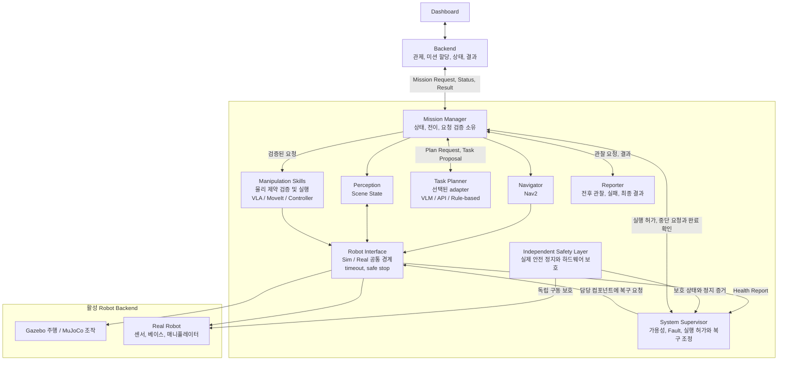

# 기술 개요(Technical Overview)

## 요약

끌리니는 Dashboard 요청을 받아 지정 좌석으로 왕복하고 책상 위 물체를 처리하는
ROS 2 기반 모바일 매니퓰레이터다. 이 문서는 전체 기술 지도를 제공하며 각 설계
세부는 한 문서에서만 설명한다.

## 전체 구조

아래는 합의된 책임 구조다. 모든 박스와 연결이 한 실행에 통합됐다는 뜻은 아니다.
Dashboard와 Backend는 외부 control plane이며 Robot Runtime은 Jetson을 목표로 한다.
Robot Interface는 공통 의미 경계이고 현재 구현된 중앙 adapter 패키지는 아니다.

한 실행에서는 Simulation 또는 Real backend 하나만 공통 Robot Interface의 명령과
상태를 소유한다. 시스템 가용성, Fault와 복구 정책은 System Supervisor가 관리한다.
Mission 검증, 중단과 복구 뒤 재개 판단은 Mission Manager가, 물리 제약 검증과 실제
복구는 Capability 및 담당 컴포넌트가 맡는다. 행동별 검증을 옮기는 별도 Local Guard는
두지 않는다. timeout과 safe stop은 하위 controller 및 안전 경로가 보장해야 하며,
물리적 e-stop은 Planner, cloud와 Supervisor의 생존에 의존하지 않는다.
독립 안전 계층은 필요한 책임 경계이며 실물 구현 완료를 의미하지 않는다.
Reporter는 Mission Manager에 관찰과 결과를 반환하며, Backend에는 Mission Manager만
상태와 최종 결과를 전송한다.

## 현재 구현과 통합 기준

2026-10-17 사용자는 **FSM+BT Runtime을 기준으로 Supervisor를 통합**하기로 했다.
각 경로의 구현 기준과 한계는 다음과 같다. 이 표의 코드 존재와 과거 실행 기록을
현재 실물 전체 미션의 성공 증거로 합치지 않는다.

| 경로 | 확인한 구현 | 아직 연결하거나 검증할 것 |
|---|---|---|
| Control Plane `main`, `e2fa98d` | Dashboard, queue, Gateway와 영속 결과 | 실제 사진 저장 정책 및 Robot 전체 미션 검증 |
| Runtime `65fdf06` | Gateway bridge, 상위 FSM, 청소 BT와 Nav2 adapter | 책상 관측, 계획, 실행 Mock을 실제 경로로 교체 |
| Supervisor `c63fadb` | 가용성, 허가, 복구와 기존 순차 core의 bridge | 기준 FSM+BT Runtime, production health, 정지 adapter 연결 |
| Scene/Manipulation, Runtime `65fdf06` | YOLOE-seg, Gemini, 3D 복원, 파지 선택과 별도 MuJoCo sorting | Runtime의 단일 객체 Action과 통합, 실물 조작 |
| Base `e8b9f11` | ESP32-S3 micro-ROS, 구동 허가, watchdog와 wheel odometry | 실물 통합 조건의 sensor, 제동, 안전 증거 |

현재 조작 기준은 MoveIt과 규칙 기반 Skill이다. VLA 포함은 MVP 필수 조건이 아니다.
관측의 의미 분류, Planner의 행동 제안과 실제 물리 실행을 서로 구분한다.

## 책임 지도

| 주제 | 문서 | 소유하는 질문 |
|---|---|---|
| 외부 경계 | [System Context](<01 - System Context.md>) | Dashboard, Backend, Robot은 무엇을 주고받는가? |
| 관제 | [Robot Operations and Mission Dispatch](<02 - Robot Operations and Mission Dispatch.md>) | Backend는 미션을 어떻게 할당하고 Robot 상태와 결과를 관리하는가? |
| 판단과 실행 | [Task Planning and Robot Capabilities](<03 - Task Planning and Robot Capabilities.md>) | 누가 작업을 고르고 어떤 Capability가 실행하는가? |
| 로봇 형태 | [Robot Platform XLeRobot](<04 - Robot Platform XLeRobot.md>) | 로봇의 신체와 subsystem 경계는 무엇인가? |
| 주행 | [Navigation and Mapping](<05 - Navigation and Mapping.md>) | 좌석까지 어떻게 왕복하는가? |
| 엣지, 클라우드 | [Edge Runtime Jetson Orin](<06 - Edge Runtime Jetson Orin.md>) | 로컬과 클라우드는 무엇을 담당하는가? |
| 인식 | [Perception and Scene Understanding](<07 - Perception and Scene Understanding.md>) | 장면을 어떤 계약으로 표현하는가? |
| 안전 | [Safety and Risk](<08 - Safety and Risk.md>) | 어떤 제약이 Planner보다 우선하는가? |
| 미션 | [Mission Lifecycle](<09 - Mission Lifecycle.md>) | 미션 단계와 상태 소유자는 누구인가? |
| 로봇 계약 | [Robot ROS Contract](<10 - Robot ROS Contract.md>) | Sim과 Real이 공유하는 의미는 무엇인가? |
| 소프트웨어 | [ROS 2 Software Architecture](<11 - ROS 2 Software Architecture.md>) | 패키지 책임은 어떻게 나뉘는가? |
| 하드웨어 | [Hardware Configuration](<12 - Hardware Configuration.md>) | 실제 부품, 전원, 배선은 어떻게 구성되는가? |
| 검증 | [Verification and Simulation Strategy](<13 - Verification and Simulation Strategy.md>) | 단계별로 무엇을 어디서 검증하는가? |
| 시스템 운영 | [System Supervisor](<14 - System Supervisor.md>) | 시스템 가용성, 기능 제한, 실행 허가와 복구 조정을 누가 소유하는가? |
| 조작과 보정 | [Manipulation and Calibration](<15 - Manipulation and Calibration.md>) | 관측, 파지, 실행과 놓기, 보정을 어떤 증거로 연결하는가? |

## 현재 설계 원칙

- 제품 목표와 구현 상태를 구분한다.
- Mission 상태 전이는 Mission Manager만 소유한다.
- System Supervisor는 시스템 운영 상태와 복구 작업 상태를 분리하고, Mission 실행
  허가의 만료와 철회를 관리한다. 복구만으로 Mission을 자동 재개하지 않는다.
- Planner가 제안한 행동은 Mission Manager와 Capability의 검증을 통과한 뒤에만 실행한다.
- VLM을 선택하면 고정 주기가 아니라 high-level 행동 완료, 실패와 장면 변화 checkpoint에서 재추론한다.
- Manipulation Skill은 VLA-backed 실행을 포함할 수 있다.
- Navigation과 Manipulation을 하나의 모호한 skill 목록으로 섞지 않고, 안전 정지는 일반 skill로 취급하지 않는다.
- Gazebo는 주행, MuJoCo는 책상 조작 검증을 담당한다.
- 정확한 ROS schema, parameter와 실행 명령은 구현 코드와 패키지 README가 관리한다.

## 열린 경계

통합 기준과 MVP 조작 방식은 이번 사용자 결정으로 정리했다. 기존 기술 선택의
이유가 확인되지 않은 항목과 실제 통합 조건은 [Technical Questions](<99 - Questions.md>),
분실물 처리와 데모 범위는 [Planning Questions](<../10_PLANNING/99 - Questions.md>)에서 관리한다.

## 출처

- [Runtime 현재 연결과 계약 at 65fdf06](https://github.com/asm17-moving-agent/cleany/blob/65fdf061bcc564f4d362b1994b633d7235df66d7/docs/INTEGRATION.md)
- [Control Plane Gateway at e2fa98d](https://github.com/asm17-moving-agent/cleany-control-plane/blob/e2fa98d9d823ba4e2ccb0b8ed510ac7f1badb843/docs/architecture/robot-gateway-integration.md)
- [기술 KB 구현 대조와 사용자 결정](<../40_RAW/261017 - 기술 KB 구현 대조와 사용자 결정.md>)

- [261016 - System Supervisor 설계 지시](<../40_RAW/261016 - System Supervisor 설계 지시.md>)

- [기획서 원문 요약](<../40_RAW/기획서 원문 요약.md>)

## 관련 결정

- [261017 - MoveIt과 규칙 기반 조작의 MVP 인정](<../30_DECISIONS/Planning/261017 - MoveIt과 규칙 기반 조작의 MVP 인정.md>)
- [261017 - FSM과 BT Runtime 기준 Supervisor 통합](<../30_DECISIONS/Technical/261017 - FSM과 BT Runtime 기준 Supervisor 통합.md>)
- [261016 - System Supervisor 책임과 안전 경계](<../30_DECISIONS/Technical/261016 - System Supervisor 책임과 안전 경계.md>)

- [260708 - XLeRobot 기반 플랫폼](<../30_DECISIONS/Technical/260708 - XLeRobot 기반 플랫폼.md>)
- [260714 - 4륜 메카넘 베이스](<../30_DECISIONS/Technical/260714 - 4륜 메카넘 베이스.md>)
- [260714 - Jetson Orin NX 16GB](<../30_DECISIONS/Technical/260714 - Jetson Orin NX 16GB.md>)
- [260806 - Task Planning과 Robot Capability 경계](<../30_DECISIONS/Technical/260806 - Task Planning과 Robot Capability 경계.md>)
