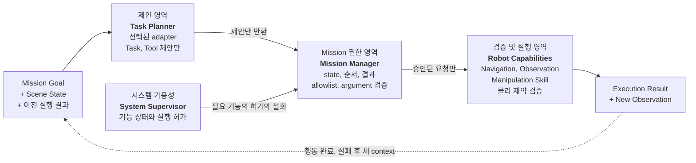

# Task Planning과 Robot Capabilities

## 요약

Cleany는 고수준 Task Planner가 Scene State를 바탕으로 처리 순서를 제안하고,
검증된 Robot Capability가 물리 동작을 실행하는 구조를 목표로 한다. 현재 Perception
구현의 인식 경로는 YOLOE-seg와 Gemini를 사용한다. Task Planner의 실행 경로와 최종
제품 기준은 별도로 관리한다.

## 책임 경계



Planner는 행동을 제안하지만 실행 권한과 Mission state를 소유하지 않는다. Mission
Manager가 Supervisor의 기능 가용성 및 실행 허가와 Mission 상태, allowlist, 기본
argument를 검증해 Capability 호출로 바꾸고,
Capability와 Robot backend가 물리 제약을 확인한다. Mission cancel은 Mission
Manager가 처리하고, safe stop과 e-stop은 Planner 응답과 독립된 하위 경로에서
물리 실행을 제한하거나 중단한다.

## Planner 책임

- 책상 위 물체와 관계의 의미 해석
- 처리 가능한 대상과 미처리 대상 구분
- 여러 대상의 작업 순서 제안
- 현재 상태에서 사용할 high-level Capability와 argument 제안
- 실행 결과와 최신 관찰을 바탕으로 다음 단계, 완료 여부 판단

Planner는 grasp pose, IK, joint trajectory, motor command를 직접 만들지 않고
Mission Manager의 state를 변경하지 않는다.

## 현재 구현과 확장 후보

모델 하나를 고르는 문제가 아니다. 장면 이해 경로와 Task Proposal 생성 경로를 각각
측정해 조합한다.

| 후보 | 역할 | 공통 계약 | 판단 기준 |
|---|---|---|---|
| RuleBasedPlanner | E2E 경계와 실패 흐름 검증, detector 결과 기반 순서 선택 | Scene 입력, high-level task 출력 | 사전 정의 규칙만 사용 |
| 로컬 VLM adapter | 장면 의미 해석 또는 structured task proposal 후보 | 동일한 Scene State, Task Proposal | Jetson 지연, 자원 사용, 정확도 |
| API VLM adapter, ER 2 포함 | 장면 의미 해석 또는 structured task proposal 후보 | 동일한 Scene State, Task Proposal | 네트워크 지연, 실패, 비용, 개인정보 |
| Gemini | 현재 Perception 의미 분류에 사용 | Scene State의 label과 분류 | 분류 정확도, 지연, 불확실성 처리 |
| YOLOE-seg | 현재 Perception의 object region과 instance mask 생성에 사용 | Scene State의 물체 영역과 mask | 작은 물체 정확도, 처리 지연, 조작 적합성 |

YOLOE-seg와 Gemini는 Perception 결과를 만든다. 이 결과는 Planner의 행동 제안이나
Mission Manager의 실행 승인을 대신하지 않는다. 인식 경로가 바뀌어도 Mission Manager와
Capability 경계는 바뀌지 않는다.

## VLM 호출과 재추론

MVP 작업 구역은 사람이나 외부 물체가 개입하지 않는 준정적 환경이다. VLM을 선택하면 입력은
안전한 checkpoint의 정지 장면을 사용하지만, 로봇 행동으로 물체가 낙하하거나 전도되거나
가려진 대상이 드러날 수 있으므로 최초 추론 결과를 끝까지 고정하지 않는다.

| Trigger | VLM 처리 |
|---|---|
| 책상 도착 후 작업 전 관찰 | 최초 장면을 해석하고 다음 high-level 행동 하나를 제안 |
| 행동 success, failed, blocked | 실행 결과와 새 장면으로 다음 행동, 완료 여부 재판단 |
| 예상 밖 장면 변화 | 기존 proposal을 폐기하고 최신 Scene으로 재추론 |

VLM을 사용할 때 고정 주기로 호출하거나 trajectory 실행 중 활성 동작을 변경하지 않는다. 실행
중 물체의 낙하 또는 전도, controller fault와 collision에 대한 즉시 대응은 Capability와
Robot backend가 맡고, 행동이 끝나거나 중단된 뒤 VLM이 의미와 다음 행동을 판단한다.

예를 들어 보틀이 쓰러지면 기존 위치를 전제로 한 proposal을 계속 사용하지 않는다.
Capability가 실행을 종료, 차단하고 새 장면을 관찰한 뒤, VLM이 재시도, 보류, 다른 대상
처리 중 다음 high-level 행동을 제안한다.

## Robot Capability 분류

| 분류 | 예시 | 현재 소유 |
|---|---|---|
| Navigation | 대상 좌석 이동, 대기 위치 복귀 | Navigator, Nav2 |
| Manipulation Skill | 쓰레기 수거, 시뮬레이션의 전용 보관함 투입, arm reset | Skill Executor와 실행 backend |
| Observation | 작업 전후 촬영, 실행 결과 확인 | Perception |

시뮬레이션에는 전용 탑재 보관함으로 분실물을 옮기는 경로가 있다. 실제 제품의
분실물 처리 행동과 운영자 인계는 Planning의 미결정 범위를 따른다. 기술 경로의
존재나 Planner 제안만으로 처리 정책을 확정하지 않는다.

`Robot Capabilities`는 중립적인 상위 용어다. 선택된 Planner가 Navigation까지 직접
호출할지, 책상 도착 후 Manipulation만 제안할지는 아직 정하지 않는다.
Mission cancel, safe stop과 e-stop은 Robot Capability로 분류하지 않는다.

현재 Manipulation 실행 기준은 규칙 기반 Skill, MoveIt 계획과 ROS controller 실행이다.

여기서 Robot Capability는 실행 기능의 상위 의미다. Supervisor가 관리하는
`BASE_MOTION`, `NAVIGATION`, `MANIPULATION`, `VISUAL_PERCEPTION`,
`MOBILE_MANIPULATION`은 이 기능을 사용할 수 있는지 나타내는 가용성 분류다.
실행 가능한 Skill 목록이나 Planner tool 목록과 일대일로 같다고 가정하지 않는다.
가용성의 의존성과 UNKNOWN 처리는 [System Supervisor](<14 - System Supervisor.md>)를 따른다.

## Manipulation Skill과 VLA

현재 Manipulation 실행 기준은 규칙 기반 Skill, MoveIt 계획과 controller 실행이다.
2026-10-17 사용자 결정으로 이 방식도 MVP 조작 기준을 충족할 수 있다. VLA를 필수로
요구하지 않으며, 향후 다른 실행 backend를 평가할 수 있는 경계는 유지한다.

```text
승인된 행동과 object/destination
→ 입력 및 실행 조건 검사 → 파지, 계획 → arm과 gripper 실행
→ 행동 결과 + 정지, 물체, 놓기 상태 → 최신 관찰
```

현재 Scene/Grasp 및 MuJoCo 경로와 Mission의 단일 객체 Action Mock은 별도다.
[Manipulation and Calibration](<15 - Manipulation and Calibration.md>)에서 도달성,
실행과 성공 판정의 차이를 관리한다. Gemini의 의미 분류를 VLA action 생성이나
독립 Task Planner 구현으로 부르지 않는다.

## MVP 실행 검증

MVP에서는 별도 `Local Guard` 컴포넌트나 package를 두지 않는다. 실행 전 검증은
기존 책임 경계에 다음처럼 나눈다.

| 검증 | 소유 위치 |
|---|---|
| 필요한 기능이 가용하고 시스템 실행 허가가 유효한가 | System Supervisor와 Mission Manager |
| 현재 Mission 단계에서 허용된 요청인가 | Mission Manager |
| allowlist에 있는 Capability와 기본 argument인가 | Mission Manager |
| object, destination ID가 현재 관찰과 일치하는가 | Mission Manager, Capability |
| workspace, joint, collision, timeout 조건을 만족하는가 | Capability, Robot backend |
| 불확실한 분실물 정책을 임의로 실행하지 않는가 | Mission Manager |

Supervisor는 시스템 가용성을 관리하며 object, argument, collision 검증을 대신하지
않는다. 이 행동별 검증이 중복되고 독립 lifecycle과 interface가 필요해질 때 별도
Guard 추출을 재검토한다.

## Stop 경계

stop은 Planner가 선택하는 일반 skill로 보지 않는다. Mission cancel, 로컬 safe stop,
물리적 e-stop은 서로 다른 우선순위의 제어 경로이며 선택된 AI 응답과 독립적으로
동작해야 한다.

## 검증 순서

1. FSM+BT Runtime에서 수락, 객체 하나 실행, 재관찰, 완료와 실패 경계를 확인한다.
2. 현재 YOLOE-seg, Gemini 관찰을 같은 snapshot 및 실패 계약으로 연결한다.
3. 승인된 단일 객체 Action을 실제 조작 backend에 연결해 계획과 물리 실행을 구분한다.
4. 기준 Runtime에 Supervisor 허가, 중단과 복구 후 재검증을 연결한다.
5. 통제된 실물 시나리오에서 전후 관찰, 결과와 독립 정지를 검증한다.

위 순서는 통합 대상과 검증 경계다. 각 단계의 완료 선언이나 VLA, Streaming의
필수 채택을 뜻하지 않는다.

## 관련 문서

- [Perception and Scene Understanding](<07 - Perception and Scene Understanding.md>)
- [Safety and Risk](<08 - Safety and Risk.md>)
- [Mission Lifecycle](<09 - Mission Lifecycle.md>)
- [System Supervisor](<14 - System Supervisor.md>)

## 출처

- [기준 Runtime의 청소 BT 계약 at 65fdf06](https://github.com/asm17-moving-agent/cleany/blob/65fdf061bcc564f4d362b1994b633d7235df66d7/ros2_ws/src/cleany_interfaces/docs/mission.md)
- [현재 조작 실행 reference at 65fdf06](https://github.com/asm17-moving-agent/cleany/blob/65fdf061bcc564f4d362b1994b633d7235df66d7/ros2_ws/src/cleany_skill_executor/docs/manipulation.md)
- [기술 KB 구현 대조와 사용자 결정](<../40_RAW/261017 - 기술 KB 구현 대조와 사용자 결정.md>)

- [261016 - System Supervisor 설계 지시](<../40_RAW/261016 - System Supervisor 설계 지시.md>)

- [Gemini Robotics ER 2 공식자료 검증](<../40_RAW/260803 - Gemini Robotics ER 2/04 - 공식자료 검증.md>)
- [260806 - MVP Task Planning 책임 경계 결정](<../40_RAW/260806 - MVP Task Planning 책임 경계 결정.md>)

## 관련 결정

- [261017 - MoveIt과 규칙 기반 조작의 MVP 인정](<../30_DECISIONS/Planning/261017 - MoveIt과 규칙 기반 조작의 MVP 인정.md>)
- [261016 - System Supervisor 책임과 안전 경계](<../30_DECISIONS/Technical/261016 - System Supervisor 책임과 안전 경계.md>)

- [260806 - Task Planning과 Robot Capability 경계](<../30_DECISIONS/Technical/260806 - Task Planning과 Robot Capability 경계.md>)
