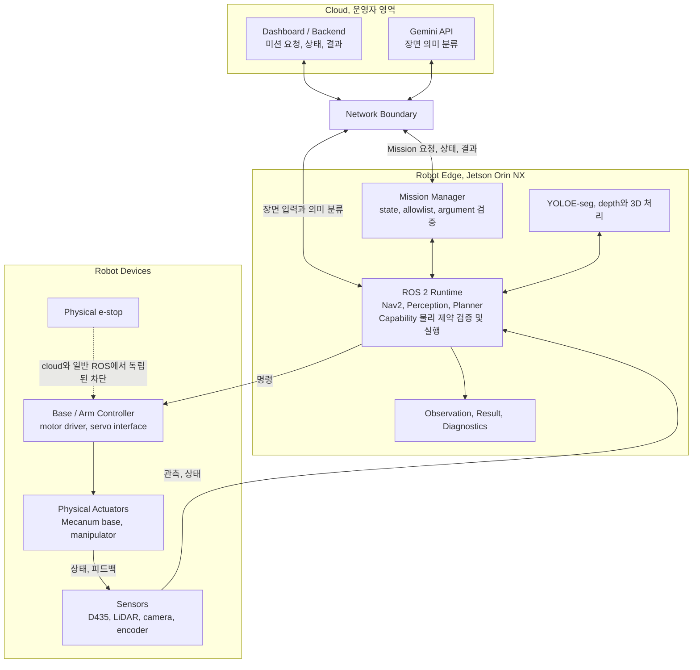

# Jetson Orin 엣지 런타임

## 요약

Jetson Orin NX 16GB는 Cleany 로봇의 ROS 2, sensor 처리, 로컬 검증, Capability
adapter와 hardware integration을 실행하는 엣지 컴퓨터다. 특정 cloud VLM을 로컬에서
실행하기 위해 정해진 장치는 아니다. 현재 YOLOE-seg 인식과 로컬 VLM 확장 후보의
실행 조건 및 자원 측정은 각각 구분한다.

## 배포 구조

Cloud는 고수준 요청과 의미 분류를 제공하지만 물리 실행과 안전 권한은 Robot에 남는다.
Backend 연결 단절과 Gemini 추론 실패를 구분한다. Backend가 끊겨도 로컬 허가와 안전
조건이 유효하면 수락한 미션을 계속할 수 있고, 필요한 의미 분류를 얻지 못한 새 행동은
시작하지 않는다. Supervisor 허가 상실과 하위 정지는 각각 로컬 경로에서 처리한다.

## 로컬 책임

- ROS 2 node와 Mission Manager 실행
- RGB-D, LiDAR, IMU, encoder 입력 처리
- Nav2와 base adapter 실행
- YOLOE-seg, depth, 3D 위치 추정 등 현재 Perception 경로 실행
- MoveIt, 규칙 기반 Manipulation Skill과 controller adapter 실행
- Mission 단계, Planner 출력 schema, Capability allowlist, 기본 argument 검증
- Capability adapter의 workspace, joint, collision, timeout 검증
- timeout, cancel, safe stop과 장치 상태 감시
- 실행 결과, 전후 관찰, 진단 로그 생성

## Cloud 책임 후보

Gemini API는 현재 Perception의 장면 의미 분류에 사용한다. 클라우드는 하드웨어 안전,
고주기 제어와 네트워크 장애 시 정지를 담당하지 않는다. 추론 요청은 고정 주기가 아니라 작업 전 관찰과
high-level 행동의 완료, 실패, 장면 변화 checkpoint를 기준으로 한다.

## 배포 목표와 확인된 실행의 차이

Jetson 선택과 x86 개발, 시뮬레이션 결과는 다른 근거다. Native ROS와 AI container의
혼합 배포는 Raw 조사 자료에 정리돼 있지만, 그 자료만으로 최종 배포 선택이나
Jetson 동시 실행 성능을 확정하지 않는다. 모델 경로, GPU 접근, 네트워크 및 ROS
경계를 고정한 실제 배포 검증이 필요하다. 정확한 설치와 실행 계약은 구현 문서가 관리한다.

## 리소스 원칙

- 동시에 필요한 모델과 node를 실제 입력으로 측정한다.
- GPU, CPU, memory, thermal, power budget을 평균이 아니라 peak 기준으로 확인한다.
- 사용하지 않는 모델을 상시 적재하지 않고 adapter별 lifecycle을 분리한다.
- cloud 응답을 기다리는 동안 base와 arm의 안전 상태는 로컬에서 유지한다.
- 모델 버전과 runtime 설치법은 구현 레포의 DEVELOPMENT_SETUP, package README가
  관리한다.

## 실패 경계

| 실패 | 로컬 기본 책임 |
|---|---|
| API VLM timeout, API 오류 | 새 물리 행동을 시작하지 않고 실패 결과 반환 |
| Perception adapter 실패 | 잘못된 scene을 Planner에 정상값으로 전달하지 않음 |
| node 중단, command timeout | backend가 안전한 정지 상태로 전환 |
| thermal, memory 부족 | 진단 기록 후 Capability 실행 차단 또는 종료 |

## 채택 판단

현재 Perception 경로는 YOLOE-seg와 Gemini를 사용한다. 인식 정확도, 지연과 실패 형태는
구현 및 검증 결과에 따라 관리한다. Orin 선택 자체가
온디바이스 VLM/VLA 채택을 의미하지 않는다.

## 관련 문서

- [Perception and Scene Understanding](<07 - Perception and Scene Understanding.md>)
- [Safety and Risk](<08 - Safety and Risk.md>)
- [Hardware Configuration](<12 - Hardware Configuration.md>)

## 출처

- [Jetson 혼합 배포 조사 기록](<../40_RAW/40_Research/260818 - Jetson 네이티브·컨테이너 혼합 아키텍처/00 - README.md>)
- [현재 Perception 모델과 실행 조건 at 65fdf06](https://github.com/asm17-moving-agent/cleany/blob/65fdf061bcc564f4d362b1994b633d7235df66d7/ros2_ws/src/cleany_perception/docs/runtime.md)
- [실행 환경과 배포 진입점 at 65fdf06](https://github.com/asm17-moving-agent/cleany/blob/65fdf061bcc564f4d362b1994b633d7235df66d7/docs/RUNNING.md)

- [260714 - Jetson Orin NX 16GB](<../30_DECISIONS/Technical/260714 - Jetson Orin NX 16GB.md>)

## 관련 결정

- [260714 - Jetson Orin NX 16GB](<../30_DECISIONS/Technical/260714 - Jetson Orin NX 16GB.md>)
- [260806 - Task Planning과 Robot Capability 경계](<../30_DECISIONS/Technical/260806 - Task Planning과 Robot Capability 경계.md>)
