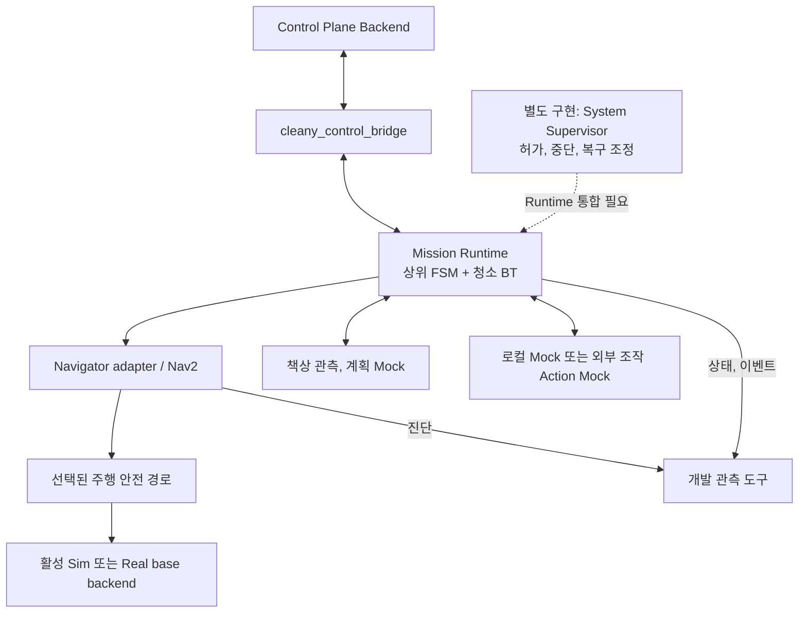

# ROS 2 소프트웨어 아키텍처

## 요약

Backend의 배차, Robot의 미션 실행, 시스템 가용성과 개별 동작을 분리한다.
현재 연결된 경로와 별도 브랜치의 기능을 구분한다. 컴포넌트 이름이 존재하거나
목표 구성도에 포함됐다는 사실을 통합 구현 완료로 해석하지 않는다.

## 현재 연결과 통합 대상

아래 실선은 `feat/runtime-integration`의 `65fdf06`에서 확인한 실행 연결이다.
점선은 별도 브랜치의 Supervisor를 이 Runtime에 연결할 통합 경계다.

이 그림의 Sim/Real base는 하위 계약의 대체 대상이다. 위 Runtime의 실물 미션 가동을
뜻하지 않는다. Supervisor 브랜치는 별도의 순차 Mission core에 허가 bridge를 연결했으며,
두 브랜치의 상태 전이와 재개 의미를 그대로 합친 실행은 확인하지 않았다.

별도의 Scene/Grasp 경로는 RGB-D에서 물체와 점군을 만들고 파지 후보 및 MoveIt
검증을 수행한다. MuJoCo sorting은 이 경로를 사용하지만 Mission의 조작 Mock 서버와
같은 구현으로 취급하지 않는다. 연결 조건은 [Manipulation and Calibration](<15 - Manipulation and Calibration.md>)을 따른다.

## 책임과 구현 경계

| 경계 | 현재 책임과 구현 범위 |
|---|---|
| Control Plane Backend | 대기열, 외부 lifecycle, Gateway event와 결과 저장 |
| `cleany_control_bridge` | WebSocket과 ROS 변환, snapshot 동기화, outbox 재전송 |
| `cleany_mission_manager` | 수락, 상위 FSM, 청소 BT, 중복 실행 방지와 최종 보고; 책상 입력은 Mock |
| `cleany_system_supervisor` | 별도 브랜치의 가용성, Fault, 허가와 복구 조정; production adapter 통합 필요 |
| `cleany_navigation`와 Navigator adapter | 공통 주행, 관측 보호와 목적지 도착 확인 |
| `cleany_perception`, `cleany_grasping`, `cleany_skill_executor` | 별도 센서 기반 관찰, 파지 후보, 도달성 검증 및 시뮬레이션 실행 |
| `cleany_base_driver`, `cleany_base_odometry`, ESP32 | 명령 변환, MCU feedback, wheel odometry와 구동 허가 |
| `cleany_interfaces`, `cleany_base_interfaces` | 공유 ROS 계약과 단위 및 식별 의미 |
| `cleany_robot_interface` | 공통 adapter의 설계 경계; 이 Runtime에서 구현된 중앙 통과 패키지가 아님 |
| `cleany_planner` | 독립 패키지의 구현을 전제로 하지 않음; Runtime의 Mock Planner와 실제 인식 의미 분류를 구분 |
| `cleany_logger`와 개발 관측 | 미션 journal, 관찰 자료 전달, rosbag, 진단 기록을 목적별로 구분; 하나의 완성된 저장 기능으로 합치지 않음 |
| 독립 안전 계층 | 실제 정지와 하드웨어 보호 책임; Supervisor의 상태 보고만으로 구현 완료 판정 불가 |

## 의존성과 상태 소유권

Mission core는 ROS와 장치 SDK 대신 port를 사용한다. 구체적인 Navigator 및 조작
adapter가 ROS를 호출하고, Backend는 Robot 내부 FSM을 직접 변경하지 않는다.
공통 Robot Interface를 목표로 하더라도 현재 adapter가 실제 어디에 있는지 유지한다.

System Supervisor는 시스템 운영 상태, 복구 작업과 실행 허가를 소유한다. Mission은
자신의 lifecycle과 복구 후 재검증을 소유한다. Skill은 행동 내부의 순서와 물리 제약을
소유한다. 일반 Skill 실패와 Nav2 내부 Recovery를 모두 시스템 Fault로 승격하지 않는다.

Topic은 센서와 상태, Service는 짧은 요청, Action은 취소와 결과 확인이 필요한 작업에
사용한다. 정확한 schema, QoS와 endpoint는 구현 레포의 계약 reference가 관리한다.

## Sim, Real과 관측

한 실행에서 같은 명령, canonical odometry와 TF edge의 소유자는 중복되지 않아야
한다. 실물 MCU, Mock MCU와 simulator를 같은 명령 경로에 겹쳐 연결하지 않는다.
Simulator private hook과 평가용 ground truth를 공통 제어 계약으로 노출하지 않는다.

개발 모니터는 실행 출처, 입력 단절, event gap과 기록을 관찰한다. 화면 표시나
replay가 미션 실행 및 물리 검증을 대신하지 않는다. Runtime journal의 실행 결과,
Backend의 저장 ACK와 작업 전후 이미지의 저장 확인도 다른 증거다.

## 관련 문서

- [Technical Overview](<00 - Technical Overview.md>)
- [Mission Lifecycle](<09 - Mission Lifecycle.md>)
- [Robot ROS Contract](<10 - Robot ROS Contract.md>)
- [System Supervisor](<14 - System Supervisor.md>)
- [Manipulation and Calibration](<15 - Manipulation and Calibration.md>)

## 출처

- [현재 연결 흐름과 reference 색인 at 65fdf06](https://github.com/asm17-moving-agent/cleany/blob/65fdf061bcc564f4d362b1994b633d7235df66d7/docs/INTEGRATION.md)
- [Runtime과 Gateway 계약 at 65fdf06](https://github.com/asm17-moving-agent/cleany/blob/65fdf061bcc564f4d362b1994b633d7235df66d7/ros2_ws/src/cleany_interfaces/docs/mission.md)
- [Supervisor 구현 범위 at c63fadb](https://github.com/asm17-moving-agent/cleany/blob/c63fadb467afac08cc62a3cfd0a5af7c59b6e8b7/ros2_ws/src/cleany_system_supervisor/README.md)
- [Control Plane 구조 at e2fa98d](https://github.com/asm17-moving-agent/cleany-control-plane/blob/e2fa98d9d823ba4e2ccb0b8ed510ac7f1badb843/docs/architecture/robot-gateway-integration.md)

## 관련 결정

- [261017 - FSM과 BT Runtime 기준 Supervisor 통합](<../30_DECISIONS/Technical/261017 - FSM과 BT Runtime 기준 Supervisor 통합.md>)
- [261016 - System Supervisor 책임과 안전 경계](<../30_DECISIONS/Technical/261016 - System Supervisor 책임과 안전 경계.md>)
- [260806 - Task Planning과 Robot Capability 경계](<../30_DECISIONS/Technical/260806 - Task Planning과 Robot Capability 경계.md>)
- [261002 - Manipulation 결과와 안전 상태 보존](<../30_DECISIONS/Technical/261002 - Manipulation 결과와 안전 상태 보존.md>)
