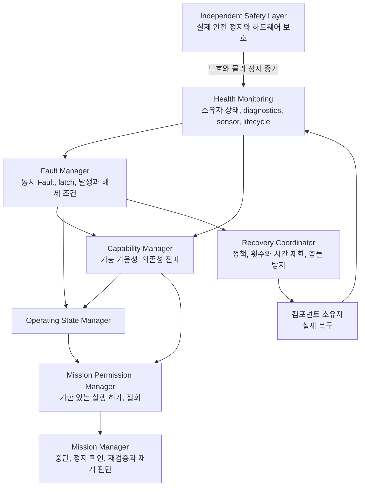

# System Supervisor

## 요약

System Supervisor는 로봇 내부의 시스템 가용성, Fault, Capability, 운영 상태와 Mission
실행 허가를 관리한다. 복구 정책과 조정은 Supervisor가, 실제 복구는 해당 컴포넌트가,
복구 뒤 재개 또는 재계획은 Mission Manager가 소유한다.

Supervisor는 독립 안전 계층을 대체하지 않는다. 시스템 가용성이 확인됐다는 사실과
특정 행동의 물리 안전성, 실제 정지 완료는 별도 증거로 판단한다.

## 책임과 데이터 흐름

| 구성요소 | 소유 책임 | 책임 밖 |
|---|---|---|
| Health Monitoring | 의미 있는 상태 보고와 freshness 확인 | 운영 상태 직접 변경 |
| Fault Manager | 활성 Fault 집합, 발생과 해제, latch | 모든 작업 실패의 Fault 승격 |
| Capability Manager | 기능별 가용성과 의존성 | 특정 파지, 경로, 자세의 안전 판정 |
| Operating State Manager | 필수 기능과 안전 증거에 따른 운영 상태 | 복구 진행 상태 |
| Recovery Coordinator | 복구 정책, 실행 여부, 제한과 결과 검증 | 컴포넌트 내부 복구 알고리즘 |
| Mission Permission Manager | 실행 허가, 만료와 철회, 중단 추적 | Mission 자동 재개 |
| Mission Manager | Mission 실행과 중단, 환경 및 작업 재검증 | 시스템 Fault의 전체 정책 |
| Task Executor와 Skill | 개별 작업 실행과 작업 수준 실패 처리 | 시스템 전체 잠금 해제 |
| Independent Safety Layer | Supervisor 없이도 필요한 실제 정지와 하드웨어 보호 | Mission 순서와 재계획 |

기존 diagnostics, heartbeat, sensor와 lifecycle을 우선 활용한다. 단순 Topic 수신,
node 열거, Action 수락만으로 실제 가용성을 선언하지 않는다. camera frame과
Perception 준비 상태, Arm 통신 상태와 base 이동에 안전한 팔 상태도 구분한다.

## Fault와 기능 가용성

Fault는 code, source, severity, 영향 Capability, 발생 및 마지막 관측 시각, 활성 여부,
latched 여부와 recovery policy를 유지한다. 여러 Fault를 동시에 관리하며 발생과
해제 조건을 분리한다. 정상 복귀에는 fresh 상태가 안정적으로 유지되는 증거가 필요하다.

Capability는 `AVAILABLE`, `UNAVAILABLE`, `UNKNOWN`으로 표현한다. 초기 상태와
정보를 확인할 수 없거나 오래된 경우는 사용 가능으로 판단하지 않는다. 필수 하위
기능이 제한되면 종속 기능도 제한한다.

아래는 초기 가용성 분류다. 필수 기능 집합과 정확한 의존성 및 입력 조건은 구현
설정에서 관리하며, 모든 동작에 동일한 기능 집합을 요구하지 않는다.

| Capability | 의미와 의존성 |
|---|---|
| BASE_MOTION | base 가용성과 이동을 허용할 팔 상태 확인 |
| NAVIGATION | BASE_MOTION, LiDAR, Localization과 Navigation 준비 상태 |
| MANIPULATION | Arm 실행 계층의 가용성 |
| VISUAL_PERCEPTION | camera 입력과 Perception 준비 상태 |
| MOBILE_MANIPULATION | Navigation, Manipulation과 Visual Perception의 결합 |

기능별 제한을 우선 적용하되 필수 기능이나 시스템 안전을 확인할 수 없으면 전체
자동 운영을 잠근다. 개별 파지 실패, 일시적 IK 실패와 Nav2 내부의 정상 Recovery는
원칙적으로 해당 Skill 또는 컴포넌트가 처리한다.

## 운영 상태와 복구 작업 상태

| 운영 상태 | 의미 |
|---|---|
| INITIALIZING | 시작 후 필수 기능과 안전 증거를 검증 중 |
| OPERATIONAL | 기능과 안전 조건이 검증돼 자동 운영 가능 |
| DEGRADED | 일부 기능이 제한되지만 허가된 동작은 가능 |
| FAULT_LOCKED | 필수 기능 또는 안전 조건 미충족으로 자동 운영 금지 |

운영 상태는 Fault severity 하나가 아니라 활성 Fault, 필수 Capability와 안전 증거를
함께 평가한다. `FAULT_LOCKED` 해제에는 원인 해소와 안전 재검증이 필요하다.

복구 작업은 별도로 `IDLE`, `RUNNING`, `SUCCEEDED`, `FAILED`, `CANCELED`를 가진다.
운영은 잠겨 있어도 안전 조건이 검증되면 해당 컴포넌트 복구를 수행할 수 있다.
복구가 진행 중이라는 이유만으로 기능이 사용 가능해지지는 않는다.

## 실행 허가와 Mission 중단

1. Mission Manager가 필요한 Capability와 환경 및 작업 조건을 확인하고 허가를 요청한다.
2. Supervisor가 필요한 기능과 운영 상태에 근거해 기한 있는 허가를 발급한다.
3. Mission Manager는 실행 중에도 허가의 만료, 철회와 Supervisor 가용성을 반영한다.
4. 필요한 기능이 상실되면 허가를 철회하고 Mission 중단을 요청한다. 요청 수락과
   실제 중단 완료를 구분하며 실패나 시간 초과는 운영 잠금으로 확대한다.
5. 복구 뒤 Mission Manager가 물체, 팔 자세, 위치와 작업 상태를 다시 검증하고
   재개, 재계획 또는 종료를 결정한다. Supervisor가 직접 재개하지 않는다.

Supervisor 재시작은 새 실행 세대에서 초기 검증부터 시작하며 이전 실행 허가는
무효다. 허가 갱신이 끊기면 Mission client가 자신의 시간 기준으로 만료를 집행한다.
오래된 상태 snapshot이나 heartbeat 하나가 무기한 실행 권한을 부여하지 않는다.

이 허가 계약은 임의의 저수준 명령원을 물리적으로 차단한다는 뜻이 아니다. 실제
정지와 하위 명령 소유권은 controller 및 독립 안전 계층에서 별도 보장해야 한다.

## 복구 조정과 완료 증거

복구는 담당 컴포넌트에 요청하고, 시도 횟수와 시간 제한 및 동시 실행 충돌을 관리한다.
복구 시작에는 필요한 안전 증거와 중단 완료 확인이 있어야 한다. component Action이
성공해도 그 결과 이후의 fresh health와 안정화 확인 전에는 복구 완료로 판단하지 않는다.

취소나 timeout 뒤 원격 작업이 실제로 끝났는지 알 수 없으면 추가 복구를 겹쳐 보내지
않는다. 실패 시 기능 제한 또는 운영 잠금을 유지한다. Nav2 자체 Recovery와 Lifecycle
Manager의 기능을 Supervisor에 다시 구현하지 않는다.

E-stop은 software reset만으로 해제할 수 없다. 물리 해제 확인과 보호 계층 상태가
검증되어야 한다. ESP32 통신 두절에서는 ROS 정지 전달 성공을 전제로 삼지 않는다.

## 현재 구현 범위와 검증 한계

이 절은 구현 레포 `feat/system-supervisor`의 `c63fadb`를 기준으로 한다. main 반영,
원격 공개, 배포 완료 또는 실제 로봇 가동을 의미하지 않는다.

- `cleany_system_supervisor`에 단일 ROS node, ROS 비의존 core와 비동기 통신 경계를
  구현했다. 정확한 Fault 목록, dependency, QoS, deadline과 실행 명령은 package
  README와 설정에서 관리한다.
- Mission bridge에 실행 세대, version과 TTL을 사용하는 허가 취득 및 갱신, 철회와
  중단 Action을 연결했다. 정지 확인과 기존 실행 호출 종료를 구분하며, 중단 뒤 늦은
  성공 결과는 Mission을 진행시키지 않는다. 재개에는 Mission의 명시적 재검증을 요구한다.
- pure core 및 synthetic ROS graph로 Fault, 허가, 복구와 재시작 경계를 검증했다.
  실제 주행, 파지, MCU 통신 차단 뒤 모터 정지나 물리 E-stop 검증은 하지 않았다.
- 실제 독립 안전 상태 adapter, Arm health 및 이동 안전 상태, Perception readiness,
  컴포넌트 Recovery Action과 production Mission adapter 연결은 남아 있다.
- 기본 profile은 필수 안전 증거가 없으면 운영을 잠근다. 실제 Recovery 제공자가
  없어 기본 자동 복구는 비활성이다. 제공 launch는 Supervisor만 시작한다.
- 기존 무감독 core와 임의의 저수준 명령원은 허가 bridge로 자동 전환되지 않는다.
  실제 자동 운영에는 명령 소유권과 하위 안전 경계를 포함한 통합 검증이 필요하다.

## 관련 문서

- [Mission Lifecycle](<09 - Mission Lifecycle.md>)
- [Safety and Risk](<08 - Safety and Risk.md>)
- [Robot ROS Contract](<10 - Robot ROS Contract.md>)
- [ROS 2 Software Architecture](<11 - ROS 2 Software Architecture.md>)
- [Verification and Simulation Strategy](<13 - Verification and Simulation Strategy.md>)

## 출처

- [261016 - System Supervisor 설계 지시](<../40_RAW/261016 - System Supervisor 설계 지시.md>)
- [Supervisor README at c63fadb](https://github.com/asm17-moving-agent/cleany/blob/c63fadb467afac08cc62a3cfd0a5af7c59b6e8b7/ros2_ws/src/cleany_system_supervisor/README.md)
- [Supervisor core at c63fadb](https://github.com/asm17-moving-agent/cleany/blob/c63fadb467afac08cc62a3cfd0a5af7c59b6e8b7/ros2_ws/src/cleany_system_supervisor/cleany_system_supervisor/supervisor.py)
- [Mission supervision bridge at c63fadb](https://github.com/asm17-moving-agent/cleany/blob/c63fadb467afac08cc62a3cfd0a5af7c59b6e8b7/ros2_ws/src/cleany_mission_manager/cleany_mission_manager/ros_supervision.py)

## 관련 결정

- [261016 - System Supervisor 책임과 안전 경계](<../30_DECISIONS/Technical/261016 - System Supervisor 책임과 안전 경계.md>)
